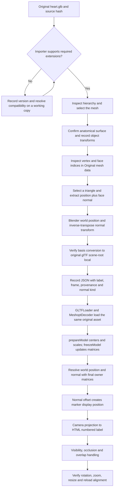

# Documentation maintenance

The application serves its developer documentation at `/docs`. `/` still redirects to `/anatomy`.
The existing viewer links to docs from the desktop list and compact mobile selector; the docs
header links back to the viewer. No hosting registration or deployment is part of this change.

## Content and routing

`src/app/app.routes.ts` dynamically imports `features/docs/docs.routes.ts`. That route collection
mounts `DocsLayoutComponent`, resolves known page IDs through `DocsPageComponent`, and lazily
loads `DocsSourceComponent` for `/docs/source/:sourceId`. Unknown pages have a recovery view.

`docs.models.ts` defines typed pages, sections and block variants. Curated content lives in:

- `content/foundation.pages.ts`: home, setup, architecture, tree, Angular, data and services.
- `content/engine.pages.ts`: viewer, Three.js, loading, geometry, rays and camera.
- `content/blender.generated.ts`: the complete Blender tutorial generated from this file.
- `content/dental.pages.ts`: calibrated model behavior and detailed algorithms.
- `content/state.pages.ts`: hotspots, capture, storage and performance.
- `content/engineering.pages.ts`: testing, diagnosis, glossary and maintenance.
- `content/integration.page.ts`: seven scenarios and compiled source examples.
- `content/api.pages.ts`: API pages built from declarations and curated behavior.

Add a `page(id, title, category, description, sourcePaths, ...sections)` to the appropriate array.
If introducing a new content file, import its array in `docs-content.ts`. Sidebar, search,
breadcrumbs and previous/next navigation derive from that catalog. `DOC_CATEGORIES` determines
category ordering. The sidebar shows top-level pages and three explicit nested API shortcuts;
the API index links every exported symbol.

Use stable section IDs. `links([label, pageId])` targets pages; `pageId#sectionId` also supports a
fragment. `code()` supports a language and optional filename. `diagram()` uses accessible local
HTML/CSS steps with descriptive captions; branch conditions and messages remain maintainable
text. The renderer uses Angular interpolation and never inserts unsanitized HTML.

## Generated references

```sh
node scripts/generate-docs-api.mjs
node scripts/generate-docs-api.mjs --check
node scripts/check-docs.mjs
```

Generation scans production TypeScript under `src/app` plus `main.ts`, excluding docs, tests
and fixtures. It emits exact AST-based declarations and class members, paths/lines, full
source snapshots, import metadata and SHA256 fingerprints. It never evaluates source modules.
The source corpus is a separate lazy chunk. API declarations are strings and cannot initialize
WebGL. Type re-exports are documented at their defining modules.

Generated files are `api.generated.ts`, `sources.generated.ts`, `examples.generated.ts`,
`blender.generated.ts` and
`version.generated.ts`. Commit them with the relevant source/content updates. Version metadata
records the local HEAD baseline at generation; file fingerprints capture working-tree content.
Freshness checks deliberately do not compare the informational baseline to current HEAD,
so committing generated files does not invalidate the check. Regeneration refreshes the label.
No Git commit is created by the generator.

### Blender tutorial integration

The section **Extracting 3D Model Data Using Blender** below is the canonical tutorial.
`scripts/generate-blender-docs.mjs`, invoked by `generate-docs-api.mjs`, converts its paragraphs,
inline links/emphasis/code, H2/H3/H4 headings, lists/checklists, tables, and fenced code into
typed portal blocks. It fails on unsupported links, malformed tables/diagrams, duplicate
headings, and unclosed code fences. Keep this tutorial within those supported conventions.
Do not hand-edit `content/blender.generated.ts` or maintain a second copy of its prose.

`ENGINE_PAGES` registers that generated page after model loading, under **03 — Three.js
engine**, as **Blender & 3D Data Extraction** at `/docs/blender-data-extraction`. The sidebar,
previous/next links, and existing client-side search derive from `DOC_PAGES`; no separate
sidebar registry, route entry, or search service is needed. Source links are converted to
the existing `/docs/source/:sourceId` browser. Other documentation content remains curated
TypeScript. The portal uses native H3/H4 subheadings and preserves H2 anchors in its TOC.

The portal has no Mermaid runtime. The tutorial's Mermaid flowchart is converted into its
existing accessible HTML/CSS diagram format, including the Yes/No decision and retry path.
No code examples execute while reading documentation, and all inline content renders through
Angular bindings rather than HTML injection. After editing this Markdown, regenerate with
`node scripts/generate-docs-api.mjs`, then run `node scripts/check-docs.mjs`. A running Angular
development server rebuilds when the generated TypeScript changes; published builds need
the usual `npm run build` and the existing SPA history fallback for direct links/refresh.

Add or update `API_BEHAVIOR` in `api.behavior.ts` for significant classes/functions. Describe
parameters, results, failure behavior, mutation/ownership, dependencies, reuse boundary and a
usage example. Add `METHOD_NOTES` for public methods. Interfaces and constants need semantic
updates in the data-model/conceptual guides. Private members remain browsable implementation
details, not documented reusable contracts. Regeneration cannot replace semantic review.

## Verified integration examples

Edit `docs/examples/integration.examples.ts`, then run:

```sh
npx tsc --noEmit -p docs/tsconfig.examples.json
node scripts/generate-docs-api.mjs
```

These parameterized examples use actual constructors/functions and imports. Their extracted
text appears in the portal without executing the imported viewer/Three.js code there. Adapt
paths when copying files to a host project. Every scenario explains dependencies/assets,
initialization, cleanup and model-specific limits. Do not call the prepared dental pipeline
twice on an already subdivided model, or present its calibration as a generic tooth detector.

## Validation

```sh
npm test -- --watch=false --browsers=ChromeHeadless
npx tsc --noEmit -p tsconfig.app.json
npx tsc --noEmit -p tsconfig.spec.json
npx tsc --noEmit -p docs/tsconfig.examples.json
node scripts/check-docs.mjs
node scripts/check-assets.mjs
npm run build -- --configuration production --stats-json
node scripts/check-bundles.mjs
```

With `npm start` running separately:

```sh
node scripts/browser-smoke.mjs
node scripts/docs-browser-smoke.mjs
```

Both CDP browser scripts use Node's global `WebSocket`/`fetch`, installed Chrome, isolated
temporary profiles and local result directories. `CHROME_BIN` overrides Chrome's Windows
default path and `ANATOMY_URL` overrides `http://127.0.0.1:4200`. The viewer script requires a
development build because it inspects Angular components. Docs checks instrument canvas
contexts and network requests before loading the first page, then cover direct routes,
search/keyboard, TOC, source reload, theme, history, mobile drawer and viewer transitions.

Integrity checks enforce required topics, unique page/heading/API IDs, metadata, content links,
source paths, API existence, method notes, search coverage and snapshot freshness. Bundle
checks reject engine inputs in either the initial or documentation static import closure.
Keep source references and curated prose under review as behavior changes.

## Hosting and limits

Use an SPA navigation fallback to `index.html` for direct docs routes. Static assets must retain
their normal lookup behavior. Root-absolute catalog `/models` and `/anatomy` paths require
extra configuration/adaptation for subpath hosting; base href alone does not fix them.

The portal has no external search service, runtime Markdown engine, diagram CDN or additional
UI dependency. Token coloring is intentionally lightweight. HTML diagrams describe engineering
steps and conditions without a layout library. Browser validation in this change uses Chrome
headless; verify other browsers, assistive technologies and deployment rewrite rules in their
actual target environments.

# Extracting 3D Model Data Using Blender

**Transforms, Mesh Indices, Vertex Coordinates, Surface Normals, and Anatomical Annotation Placement**

This tutorial follows an unchanged GLB from Blender inspection to a surface anchor in the
Angular viewer. It extends the maintenance guide above; the examples below are documentation,
not newly implemented viewer features. In particular, the viewer currently renders clickable
HTML dots; numbered labels and a separate 3D marker are examples for a future integration.
Read this canonical source here, or open **Three.js engine > Blender & 3D Data Extraction**
at `/docs/blender-data-extraction`. Generation converts this section into the portal's native
TypeScript content; editing Markdown alone requires regeneration before the site changes.

## Scope, prerequisites, and verified project facts

The local repository is authoritative for implementation details. The
[inspiration repository](https://github.com/thebuggeddev/anatomy) is background, not evidence
for this Angular application's model hierarchy or annotation coordinates.

Verified by reading source, installed packages, and the JSON headers of the original GLBs:

| Item | Verified information |
|---|---|
| GLB assets | `public/models/brain.glb`, `heart.glb`, `lungs.glb`, and `liver.glb` |
| Installed runtime | Angular `18.2.14`, Three.js `0.185.1`; installed Three.js types `0.185.4` |
| Compression | All four GLBs require `EXT_meshopt_compression`, `EXT_texture_webp`, and `KHR_mesh_quantization` |
| Heart scene | Default scene `Scene`, one root node referencing glTF mesh index `0`, one triangle primitive |
| Heart node name | `tripo_node_9c16954f-d29a-4a4b-baf4-ba02eda23201` |
| Heart mesh data name | `tripo_mesh_9c16954f-d29a-4a4b-baf4-ba02eda23201` |
| Other GLB hierarchies | Each also has one root mesh node and one triangle primitive; these are not scenes containing several separately named organs |
| Annotation records | `AnatomyService` contains authored positions/normals, without Blender indices or extraction provenance |
| Blender environment | Version and importer options are unknown; Blender is not available on the command PATH in this documentation session |

Names may be adjusted by Blender or GLTFLoader, especially to avoid duplicates. Verify the
loaded names rather than assuming the data-block and object have identical names. No visual
Blender inspection or anatomical landmark identification was performed for this documentation.
No dimensions or anatomical surface measurements are asserted below.

Use a scratch Blender scene with default unit settings. Record **Help > About Blender**, the
glTF importer version/options, the source GLB path and SHA-256, and whether merging vertices
or changing shading is enabled. Do not edit, apply transforms to, or overwrite the repository
models during extraction. A hash can be obtained with PowerShell:

```powershell
Get-FileHash -Algorithm SHA256 -LiteralPath public/models/heart.glb
```

## Importing and inspecting the original GLB

1. Open Blender and start a scratch scene. Remove or hide the default cube so it cannot be
   mistaken for anatomy; this changes only the scratch scene.
2. Select **File > Import > glTF 2.0 (.glb/.gltf)**.
3. Navigate to this checkout's `public/models/` directory.
4. Select `heart.glb`, then choose **Import glTF 2.0**. Record the import options.
5. Inspect the result in the 3D Viewport. Select the imported object and use **View > Frame
   Selected** (usually numpad decimal) if it is off-screen or very small.
6. Open the **Outliner**, normally at the upper right. Expand the imported hierarchy and the
   selected object's data entry. An Empty/parent can carry transforms without surface geometry;
   a mesh object references a mesh data-block. Multiple material primitives or disconnected
   surface islands need not be separate anatomical objects.
7. Select the actual **mesh object**, not the scene, collection, light, or Empty. Confirm its
   type using the Python check below before reading geometry. Use visibility/isolation only
   in the scratch scene to inspect the surface.

**Import compatibility is a prerequisite.** These files require the three extensions in the
table above. If the importer reports an unsupported required extension, record that error
and the Blender version; do not remove an extension declaration to force import. The
[glTF importer source](https://github.com/KhronosGroup/glTF-Blender-IO/blob/main/addons/io_scene_gltf2/io/imp/gltf2_io_gltf.py)
lists managed extensions, but the development branch does not prove your installed release
supports them. Use a Blender/importer release with verified support, or obtain a decoded
inspection copy outside `public/models/`. Such a copy needs a documented conversion and
matching geometry/hierarchy before transferring anchors back to the original. Installing
tools or producing a converted asset is not part of this documentation change.

### Scene, object, and mesh terminology

| Concept | Blender meaning | Three.js / glTF relationship |
|---|---|---|
| Scene | Objects and their environment | `THREE.Scene`; GLTFLoader returns a loaded scene hierarchy as `gltf.scene` |
| Object | Transformable scene entity with an origin and optional data | `Object3D`, `Group`, or `Mesh`; glTF nodes carry transforms |
| Mesh | Reusable mesh data-block referenced by an object | A glTF mesh has primitives; a Three.js `Mesh` combines geometry and material |
| Geometry | Positions, topology, normals, UVs, and other surface data | `BufferGeometry` attributes and optional index buffer |
| Vertex | A mesh point with local XYZ coordinates | A `position` attribute entry, potentially duplicated for differing attributes |
| Edge | Connection between two vertices | Topology connection; triangle geometry usually has no separate edge-index attribute |
| Face | Polygon bounded by vertices/edges | Blender polygon; a surface primitive is normally rendered as triangles |
| Triangle | Face with three corners | Three consecutive indices, or three consecutive positions when non-indexed |

One Blender mesh can be shared by several objects with different transforms. Conversely, one
glTF mesh can become multiple Three.js meshes when it contains multiple material primitives.
An object name or mesh identifier does not identify a particular point on its surface.

## Object Transform Values

A transform places object-local geometry into its parent's coordinate system. The full chain
of parent transforms places it in world space. The object origin is the pivot/reference point;
it need not be the surface centroid or bounding-box center.

### Position / Location

Location X, Y, and Z describe the object's origin relative to its parent/reference frame,
not the coordinates of its vertices. With no parent or constraints, location corresponds to
the world origin position. With parenting, parent inverse matrices, delta transforms, or
constraints, the displayed channels alone do not describe the final world transform. Read
`obj.matrix_world.translation` for the evaluated object origin in Blender world space.
Vertex `vertex.co` remains relative to the mesh object's origin even when the object moves.

### Rotation

X/Y/Z rotations turn the object about the corresponding axes. Euler rotation is an ordered
sequence, so `XYZ` and `ZYX` can produce different orientations from the same numbers.
Blender's rotation mode can be Euler (several orders), quaternion, or axis-angle. Its UI
usually displays angles in degrees; Python Euler values are radians. Three.js Euler angles
are radians and default to order `XYZ`. A quaternion cannot be copied as three Euler angles;
use a compatible quaternion/basis conversion or a complete matrix.

### Scale

Scale X/Y/Z multiply the geometry along its axes. Uniform scale has equal components;
non-uniform scale stretches axes differently and changes how normals must be transformed.
Scale is dimensionless, not the measured object size. **Object > Apply > Rotation & Scale**
can bake those transforms into mesh coordinates while preserving appearance. Applying
transforms changes the coordinates being recorded: do not apply them halfway through this
workflow. Applied transforms often show scale `(1, 1, 1)` while the geometry retains its size.

### Dimensions and bounding boxes

Dimensions report the extents of the object's bounding box with scaling accounted for; they
are not a second scale setting. They depend on geometry and evaluated state. Do not assume
Blender's displayed Dimensions are identical to a rotated world-axis-aligned Three.js box.
For a deliberate world AABB in Blender, transform all eight `obj.bound_box` corners with
`obj.matrix_world`, then take component-wise minima/maxima. In Three.js use
`new THREE.Box3().setFromObject(model)` and `getSize()`. Units are model units until the source
unit scale has been verified; the viewer's normalized extent does not establish physical size.

### Reading transforms in Blender

1. Select the relevant mesh object and switch to **Object Mode**.
2. Place the pointer over the 3D Viewport and press **N**.
3. Open **Item > Transform**.
4. Record **Location**, **Rotation**, its rotation mode/order, **Scale**, and **Dimensions**.
5. Record parent names, constraints/delta transforms, unit settings, and whether the values
   are transform channels, mesh-local coordinates, or world measurements.

The following is a parameterized TypeScript example, not a recipe to overwrite the current
viewer normalization. All supplied values must already be converted to the intended Three.js
parent coordinate system. The installed Three.js API uses:

```ts
import * as THREE from 'three';

function applyRecordedTransform(
  model: THREE.Object3D,
  position: [number, number, number],
  rotationDegreesXYZ: [number, number, number],
  scale: [number, number, number],
): void {
  const [x, y, z] = position;
  const [rotationX, rotationY, rotationZ] = rotationDegreesXYZ.map(THREE.MathUtils.degToRad);
  const [scaleX, scaleY, scaleZ] = scale;
  model.position.set(x, y, z);
  model.rotation.set(rotationX, rotationY, rotationZ, 'XYZ');
  model.scale.set(scaleX, scaleY, scaleZ);
}
```

Use `THREE.MathUtils.degToRad()` only for values recorded in degrees; do not convert radians
again. The function assumes matching Euler order and basis. Blender is usually **Z-up**;
glTF and this Three.js viewer use **Y-up**. Both are right-handed. Changing `camera.up` does
not convert the data. The importer/exporter may rotate a basis, bake it into vertices, or
represent it with parent nodes. Copying Blender's Item fields directly is therefore unsafe.

## Mesh and Geometry Indices

### Vertex

A vertex is one point in a mesh. `mesh.vertices[i].index` is its Blender vertex index;
`vertex.co` is its mesh/object-local position. `obj.matrix_world @ vertex.co` is the world
position. The index is meaningful only within that particular mesh and topology snapshot.

### Edge

An edge joins two vertices. `edge.index` identifies an edge within Blender's edge collection;
`edge.vertices` gives its two endpoint vertex indices. Edges describe connectivity and polygon
boundaries. An edge index is neither an endpoint index nor a triangle index.

### Face

A face is a polygon. `face.index` indexes `mesh.polygons`; `face.vertices` lists its vertex
indices in order. A quad or n-gon becomes several triangles for rendering. Use
`mesh.calc_loop_triangles()` and `mesh.loop_triangles` to inspect Blender's tessellation;
each triangle's `polygon_index` refers back to a polygon, not a Three.js triangle identifier.

### Mesh identification and Three.js attribute indices

| Identifier | Meaning and scope |
|---|---|
| Object name | Scene object identifier; Blender `obj.name`, Three.js `object.name` after loader naming |
| Mesh data name | Blender `obj.data.name`; glTF mesh name is separate from its node name |
| Mesh index | For example, a node's index into glTF's `meshes` array; not a surface point or a stable scene traversal number |
| Vertex index | Blender `mesh.vertices` entry, or independently a Three.js attribute row |
| Edge index | Blender edge collection entry; not normally exported as a separate surface edge list |
| Face index | Blender polygon entry; Three.js raycast `faceIndex` instead identifies a triangle in the current geometry |
| BufferGeometry index | `geometry.index` stores references to attribute rows; it is not the Blender edge or polygon collection |

In indexed triangle geometry, triangle `t` uses attribute rows `index[3*t]`, `index[3*t+1]`,
and `index[3*t+2]`. In non-indexed geometry they are `3*t`, `3*t+1`, and `3*t+2`.
Read attributes with `getX/getY/getZ` or `Vector3.fromBufferAttribute()`; integer normalized
attributes in these quantized files must not be interpreted as raw unnormalized coordinates.

**A Blender vertex index or face index must not be assumed to identify the same geometry
element in the exported Three.js model.** Triangulation changes polygon-to-triangle mapping;
UV seams, discontinuous normals, and other corner attributes can split one Blender vertex
into several GPU vertices. Exporter processing and mesh optimization can reorder or merge
elements. Compression pipelines may also reorder and quantize data; lossless buffer decoding
alone does not necessarily change an already encoded index order. Blender import options
can change topology too. See the [glTF geometry export notes](https://docs.blender.org/manual/en/3.2/addons/import_export/scene_gltf2.html).

There is another local consideration: `prepareModel()` converts and subdivides the named
dental meshes `Group1014` and `Group1059`, and builds BVHs. BVH construction may reorder
triangle indices. Do not generalize those dental names to `heart.glb` or rely on pre-preparation
triangle indices for runtime picking. Store a surface position plus provenance instead.

## Extracting Indices from Blender

1. Select the anatomical mesh and press **Tab** to enter **Edit Mode**.
2. Use the selection icons or top-row **1** (vertices), **2** (edges), **3** (faces). Numpad
   keys control views instead; keymaps can differ.
3. Deselect everything, then select the one element you intend to inspect. Disable X-Ray if
   it causes selection through the visible surface.
4. Split an editor area or change an area's editor type to **Spreadsheet**.
5. Select the active object and its **Mesh** component. Choose the **Original** data state
   where available to inspect the same base mesh as `obj.data`.
6. Inspect the **Point** domain for vertex rows and Position XYZ; inspect **Edge** for edge
   rows; inspect **Face** for polygon rows. Availability and names vary by Blender version,
   component, and selected data state. An evaluated mesh can have different indices.
7. Use selection filtering only when supported. A visible row number in a filtered/evaluated
   view must not automatically be treated as a base-mesh index; cross-check with Python.
8. Record the element type/index and data state. Coordinates belong to points; obtain an
   edge midpoint or face center explicitly, rather than claiming every domain has Position.

Viewport index labels may require a developer display option and are not available under
the same menus in every version. If Spreadsheet domains or index labels are missing, use
the Python method below; it does not depend on those UI controls.

## Extracting Geometry Using Blender Python

Open the **Scripting** workspace, create a text in the Text Editor, paste a snippet, then
choose **Run Script**. This is Blender's Python (`bpy`), not system Python or Angular.
Read `print()` output in Blender's console; on Windows **Window > Toggle System Console**
is commonly available. The Python Console editor also works for short expressions.

Finish Edit Mode with **Tab** first so selections/coordinates are synchronized to `obj.data`.
Every extraction snippet below requires **Object Mode**, the active mesh, and an unchanged
base mesh with no geometry-altering modifiers. These checks prevent reading stale edit data.

```python
import bpy

obj = bpy.context.active_object
if obj is None or obj.type != "MESH":
    raise RuntimeError("Select a mesh object")
if obj.mode != "OBJECT":
    raise RuntimeError("Exit Edit Mode with Tab before running")

mesh = obj.data
print("Blender:", bpy.app.version_string, "Object:", obj.name, "Mesh:", mesh.name)
for vertex in mesh.vertices:
    print("Vertex Index:", vertex.index, "Position:", tuple(vertex.co))
for edge in mesh.edges:
    print("Edge Index:", edge.index, "Vertices:", tuple(edge.vertices))
for face in mesh.polygons:
    print("Face Index:", face.index, "Vertices:", list(face.vertices))
```

Positions in this output are local XYZ; edge outputs contain two vertex indices, and face
outputs contain ordered polygon vertex indices. Printing the whole heart mesh is verbose.
For focused inspection, filter a loop with `if vertex.select:` or `if face.select:` after
leaving Edit Mode, or print a known index after checking its range.

If modifiers are intentionally involved, `obj.evaluated_get(depsgraph).to_mesh()` gives
evaluated geometry; release it with `to_mesh_clear()` on that evaluated object in `finally`.
Do not mix its indices with `obj.data`, and do not assume the original GLB contains those
modifier results. This tutorial uses the original imported static surface throughout.

## Surface Normals

A normal describes a **surface direction, not a surface position**. Position tells us where
to put an annotation; the normal tells us which direction is outside the nearby surface.

### Face normals

A face normal is perpendicular to a planar face and reflects its vertex winding/orientation.
It describes the flat geometric surface and is useful for a predictable marker offset.
Non-planar n-gons do not have one normal perpendicular to every tessellated triangle; use
the chosen triangle for an exact geometric direction.

### Vertex normals

A vertex normal describes a shading direction associated with a mesh point, commonly
derived from surrounding face normals. Smooth shading interpolates normal directions across
triangles. A vertex normal need not equal any one adjacent face normal or be perpendicular
to a chosen face. Use face normals for flat contact, and shading normals when smooth visual
orientation is the intended behavior.

### Corner / split normals

Normals can belong to each face corner (Blender loops). Across a sharp edge, adjacent faces
can share a vertex position while having different corner normals. Custom normals can also
override the automatically derived shading directions. glTF stores the differing attribute
combinations as separate vertex entries when necessary. A vertex-only lookup loses this
corner distinction.

### Normal X, Y, Z and normalization

Normal components specify direction along the three axes in a declared coordinate system.
For a nonzero vector, normalization divides by its length to produce a unit vector. Its
direction is retained, and an offset multiplied by it has a predictable distance. Translation
does not affect normals. A zero normal cannot provide an outward direction.

**Illustrative numbers only:** `(0, 0, 1)` points along positive Z; `(0, 3, 4)` has length 5
and normalizes to `(0, 0.6, 0.8)`. Neither is an extracted anatomy-model normal. A tangent-space
normal map is a shading texture; it is not an object-space anatomical anchor or a vertex
normal read directly from geometry.

## Displaying Normals in Blender

1. Select the mesh, enter **Edit Mode**, and select a small surface region.
2. Open **Viewport Overlays** in the 3D Viewport header.
3. Find the mesh normal display controls, if provided by that Blender version, and enable
   **Face Normals**, **Vertex Normals**, or split/corner normals as available.
4. Adjust the displayed normal length/size to suit the model. This controls drawn helper
   lines, not stored vector magnitudes or the eventual Three.js marker offset.
5. Inspect whether lines point away from the intended surface.

Controls have moved or changed across versions. Do not assume all three normal displays
exist in every release; consult that version's manual or use extracted vectors/debug lines.
The **Face Orientation** overlay is a separate winding check: default themes commonly use
blue for front faces and red for back faces. Check the configured colors, view side, and
whether a thin/open surface is intentionally visible from the back before diagnosing it.

For an unintentionally inverted closed surface, select the affected faces in Edit Mode and
use **Mesh > Normals > Recalculate Outside**, commonly **Shift + N**. This is a repair on a
working copy, not a routine extraction step. Open surfaces, internal cavities, intentional
two-sided structures, and custom shading normals may require manual decisions; automatic
recalculation can destroy intended orientation/shading. Do not change the original models.

## Extracting Normal Values with Python

This snippet prints local face, vertex, and corner normals. It avoids depending exclusively
on the removed `calc_normals_split()` API: older Blender versions can use that method and
`loop.normal`, whereas newer versions expose computed `corner_normals`.
The [Blender Mesh API](https://docs.blender.org/api/4.0/bpy.types.Mesh.html) and
[vertex-normal API](https://docs.blender.org/api/3.6/bpy.types.Mesh.html) describe the data
collections; check the API corresponding to the recorded installed version.

```python
import bpy

obj = bpy.context.active_object
if obj is None or obj.type != "MESH":
    raise RuntimeError("Select a mesh object")
if obj.mode != "OBJECT":
    raise RuntimeError("Exit Edit Mode with Tab before running")
mesh = obj.data

for face in mesh.polygons:
    print("Face:", face.index, "Normal:", tuple(face.normal))
for vertex in mesh.vertices:
    print("Vertex:", vertex.index, "Normal:", tuple(vertex.normal))

# Feature checks support API differences without assuming the installed version.
if hasattr(mesh, "calc_normals_split"):
    mesh.calc_normals_split()
if hasattr(mesh, "corner_normals"):
    for i, normal in enumerate(mesh.corner_normals):
        print("Corner:", i, "Normal:", tuple(normal.vector))
else:
    for loop in mesh.loops:
        print("Corner:", loop.index, "Normal:", tuple(loop.normal))
```

### Transforming positions and normals to world space

For position `p` and local-to-world matrix `M`, use `M * p` with homogeneous coordinate 1.
For normal `n`, use `normalize(inverse(transpose(M3)) * n)`, where `M3` is the linear 3x3
part. Equivalently the normal matrix is `(M3 inverse) transpose`. Applying a position matrix
to a normal would add translation; applying only a direction transform fails under
non-uniform scale because it does not preserve perpendicularity to transformed tangents.

This self-contained Blender example uses `mathutils` and the first face only as a programming
example; face index `0` is **not an identified anatomical landmark**:

```python
import bpy
from mathutils import Matrix

obj = bpy.context.active_object
if obj is None or obj.type != "MESH" or obj.mode != "OBJECT":
    raise RuntimeError("Select a mesh in Object Mode")
mesh = obj.data
if not mesh.polygons:
    raise RuntimeError("Mesh has no faces")

face = mesh.polygons[0]  # Illustrative selection, not an anatomical location.
world: Matrix = obj.matrix_world.copy()
linear = world.to_3x3()
if abs(linear.determinant()) < 1e-12:
    raise RuntimeError("Singular transform: check for zero scale")
normal_matrix: Matrix = linear.inverted().transposed()
position_world = world @ face.center
normal_world = normal_matrix @ face.normal
if normal_world.length == 0:
    raise RuntimeError("Degenerate face normal")
normal_world.normalize()
print("Blender world position:", tuple(position_world))
print("Blender world normal:", tuple(normal_world))
```

The tolerance is an illustrative numerical guard, not a measured model setting. Mirrored
(negative determinant) transforms require checking winding and the intended outward side;
do not add an arbitrary sign flip without inspecting the surface. Singular matrices have no
valid inverse normal transform.

## Extracting Anatomical Annotation Coordinates

The selected GLB represents the heart asset, but its single generic mesh is not a set of
individually identified chambers or vessels. The catalog contains labels **Left Atrium** and
**Right Ventricle**; these are application metadata, not proof of a mesh segmentation or a
verified Blender landmark. Use a point on the inspected heart surface first. Assign a more
specific anatomical name only after the visible structure is confirmed by a suitable
reference/reviewer. No aorta, coronary artery, or other separate structure is asserted here.

1. Import the original model and confirm its hierarchy and orientation.
2. Identify the intended visible surface, then select its mesh in the Outliner.
3. Enter Edit Mode; navigate close enough to select a visible vertex or face precisely.
4. Select exactly one vertex or face and record the selection mode. For the script below,
   use face selection and choose one triangle.
5. Inspect local coordinates and the selected face's geometric normal.
6. Leave Edit Mode and run the extraction script. It prints local values and converts the
   selected triangle center into Blender world space, then into original glTF scene space.
7. Record a confirmed annotation label, source mesh/object, element index, position, normal,
   coordinate space, normal kind, GLB hash, Blender version, and conversion assumptions.

### Choosing an anchor technique

| Technique | Benefit | Limitation / normal choice |
|---|---|---|
| Vertex position | Existing point exactly on the selected vertex | May miss the desired landmark; vertex index is fragile and a sharp vertex has several corner normals |
| Face center | Simple repeatable anchor with a geometric normal | Triangle centroid is on the triangle; a general polygon's arithmetic center may be outside a concave/non-planar surface |
| Interpolated surface point | Precise point within a selected triangle: `p = a*p0 + b*p1 + c*p2`, nonnegative weights summing to 1 | Record triangle and weights for provenance; use its face normal or normalized interpolated corner normals; indices remain fragile |
| Named Empty | Human-readable independent anchor, no dependency on vertex numbering | Position alone contains no surface normal; store a normal or align/record an axis explicitly; it must be exported or stored separately to reach Three.js |

For an Empty, place the 3D cursor at a confirmed point (for a selected vertex, **Shift + S >
Cursor to Selected**), return to Object Mode, then **Shift + A > Empty > Plain Axes** and name
it. A selection's median is not generally an exact surface point. An Empty in a scratch
`.blend` will not magically appear in the unchanged original GLB; record its world position
and a verified normal in a sidecar record. Explicit positions or named anchors survive index
reordering, but changing the source geometry still requires revalidation.

### Selected triangle extraction and coordinate conversion

This script assumes a **fresh standard glTF import**, default units, no post-import
transforms/modifiers, and the original file remaining the runtime source. The usual conversion
from Blender Z-up world to glTF Y-up scene is `(x, y, z) -> (x, z, -y)`, a rotation of -90
degrees about X. Verify that convention against the actual importer/options and asymmetric
landmarks; do not use it to convert raw mesh-local coordinates blindly. Quantization and
importer baking can make Blender mesh-local coordinates differ from GLTFLoader attributes.
Converting the complete Blender world point includes the imported node transforms first.

```python
import bpy
import json
import math
from mathutils import Matrix

obj = bpy.context.active_object
if obj is None or obj.type != "MESH" or obj.mode != "OBJECT":
    raise RuntimeError("Select a mesh; leave Edit Mode after selecting one face")
if len(obj.modifiers):
    raise RuntimeError("This base-mesh workflow requires no modifiers")
faces = [face for face in obj.data.polygons if face.select]
if len(faces) != 1 or len(faces[0].vertices) != 3:
    raise RuntimeError("Select exactly one triangular face in Edit Mode, then press Tab")
face = faces[0]
if face.normal.length == 0:
    raise RuntimeError("Selected face is degenerate")

world = obj.matrix_world.copy()
linear = world.to_3x3()
if abs(linear.determinant()) < 1e-12:
    raise RuntimeError("Singular object/parent transform")
normal_matrix = linear.inverted().transposed()
p_blender_world = world @ face.center
n_blender_world = (normal_matrix @ face.normal).normalized()

# Standard import assumption; verify before using with a different importer/setup.
blender_to_gltf = Matrix.Rotation(-math.pi / 2, 4, "X")
p_gltf_scene = blender_to_gltf @ p_blender_world
n_gltf_scene = (blender_to_gltf.to_3x3() @ n_blender_world).normalized()

record = {
    "id": "surface-anchor-01",  # Example ID; replace with a confirmed landmark ID.
    "label": "Surface anchor 1",  # Assign anatomy only after visual verification.
    "sourceModel": "public/models/heart.glb",
    "sourceObject": obj.name,
    "sourceMesh": obj.data.name,
    "sourceFaceIndex": face.index,
    "sourceVertexIndices": list(face.vertices),
    "blenderVersion": bpy.app.version_string,
    "blenderLocalPosition": list(face.center),
    "blenderLocalNormal": list(face.normal),
    "blenderWorldPosition": list(p_blender_world),
    "blenderWorldNormal": list(n_blender_world),
    "position": list(p_gltf_scene),
    "normal": list(n_gltf_scene),
    "coordinateSpace": "local",
    "localFrame": "original-glTF-scene-root",
    "normalKind": "geometric-face",
    "conversion": "standard Blender world to glTF scene: (x, z, -y)",
}
print(json.dumps(record, indent=2))
```

Copy the JSON output into your extraction record outside the source assets, or deliberately
save a sidecar through Blender Python using `json.dump(record, file, indent=2)` with an
explicit scratch path. Also add the source hash, importer options, units, and anatomical
review status. Do not overwrite the GLB. This script only prints; it writes no project files.
The output `position` and `normal` are **original glTF scene-root local**, not final viewer
world coordinates. `meshName` is intentionally omitted from the runtime record: the source
mesh name is provenance, while the chosen runtime local frame is the model root.

For a vertex anchor use `vertex.co` and a deliberately selected vertex/corner normal, then
perform the same world and basis transforms. For an arbitrary triangle point, replace
`face.center` with the barycentric point and choose geometric versus interpolated normal
explicitly. Do not infer a surface normal from an Empty's location alone.

## Recording Extracted Numerical Values

The following table separates **verified existing application records** from new extraction
work. The first two rows reproduce `AnatomyService` numbers exactly. They are not claimed to
have been extracted with Blender or validated against the surface. Their model-root local
interpretation is verified from `HotspotProjection.register()`, not from authoring history.

| Model | Anatomical Structure | Mesh/Object | Vertex/Face Index | Position XYZ | Normal XYZ | Coordinate Space | Three.js Purpose |
|---|---|---|---|---|---|---|---|
| `heart.glb` | Left Atrium (catalog label; anatomical alignment requires verification) | Not yet extracted | Not yet extracted | `(0.14, 0.60, 0.08)` | `(0.98, -0.02, 0.18)` | Loaded model-root local, per current code | Existing built-in HTML hotspot |
| `heart.glb` | Right Ventricle (catalog label; anatomical alignment requires verification) | Not yet extracted | Not yet extracted | `(-0.05, 0.40, 0.28)` | `(-0.36, 0.15, 0.92)` | Loaded model-root local, per current code | Existing built-in HTML hotspot |
| `heart.glb` | Surface landmark requiring visual identification | `tripo_node_9c16954f-d29a-4a4b-baf4-ba02eda23201` (GLB header name; Blender name requires verification) | Not yet extracted | Not yet extracted | Not yet extracted | Not yet extracted | New surface anchor / numbered label example |

**Model** identifies the asset (retain its hash). **Anatomical Structure** is the confirmed
landmark or explicitly unverified catalog label. **Mesh/Object** identifies the source frame
and surface. **Vertex/Face Index** records element type and diagnostic provenance, not a
portable lookup key. **Position XYZ** locates the point. **Normal XYZ** gives its direction
and should include normal kind in the sidecar. **Coordinate Space** declares units, basis,
and frame owner; `local` alone is insufficient. **Three.js Purpose** explains the consumer.

No new vertex/face indices, selected surface positions/normals, or dimensions have been
extracted for this guide. The illustrative vector examples and offset ratios below are
separate from this table's existing project records.

## Using Blender Geometry Data in Three.js

### Existing OrganViewerComponent loading and preparation

Read these existing files together:

- [`OrganViewerComponent`](../src/app/features/anatomy/organ-viewer/organ-viewer.component.ts)
  orchestrates loading, preparation, camera, pointer interaction, and hotspot registration.
- [`ModelLoader`](../src/app/features/anatomy/organ-viewer/scene/model-loader.ts) loads GLBs
  with `GLTFLoader` and registers `MeshoptDecoder`; that decoder is required for these assets.
- [`prepareModel` / `freezeModel`](../src/app/features/anatomy/organ-viewer/scene/model-preparation.ts)
  prepare geometry, center/scale the model, and update/freeze matrices.
- [`HotspotProjection`](../src/app/features/anatomy/organ-viewer/hotspots/hotspot-projection.ts)
  maps cached world anchors to HTML coordinates and checks visibility.
- [`PickingController`](../src/app/features/anatomy/organ-viewer/interactions/picking-controller.ts)
  uses an inverse-transpose normal matrix for picked surface normals.

An isolated loading example using the same installed imports is below. It returns the
unprepared hierarchy; the actual component uses its `ModelLoader` rather than this function.

```ts
import * as THREE from 'three';
import { GLTFLoader } from 'three/examples/jsm/loaders/GLTFLoader.js';
import { MeshoptDecoder } from 'three/examples/jsm/libs/meshopt_decoder.module.js';

async function inspectHeart(): Promise<THREE.Group> {
  const loader = new GLTFLoader().setMeshoptDecoder(MeshoptDecoder);
  const gltf = await loader.loadAsync('/models/heart.glb');
  gltf.scene.traverse((object) => {
    console.log(object.type, object.name);
  });
  return gltf.scene;
}
```

The real load callback runs `prepareModel(object)`, adds it to the scene, and calls
`freezeModel(object)` **before** registering hotspots. Preparation resets root position and
rotation to zero and scale to one, computes a `Box3`, then uses `getCenter()` and `getSize()`.
For a non-degenerate maximum extent `d`, it sets uniform scale `s = 2 / d` and root position
`-s * center`. Child-node transforms remain part of the hierarchy. These are verified code
settings, not Blender measurements. The fallback for zero extent only subtracts the center.

Camera setup/reset places it at `(0, 0, 4)`, targets `(0, 0, 0)`, and calls `controls.update()`.
The perspective camera uses 45 degrees vertical FOV, near `0.1`, far `1000`; orbit distance
limits are `0.4` and `8`. These are current source constants. There is no model-specific
Blender coordinate converter or automatic per-model landmark fitting in the loader.

### Resolve a declared local frame into world space

The following proposed interchange interface is **not** the application's `Hotspot` type.
Here `local` with `meshName` means local to that uniquely named loaded mesh; `local` without
it means local to the loaded scene root. `world` means the **final normalized viewer world**,
never raw Blender world. The selected-triangle script above uses root local with no
`meshName`, avoiding dependence on importer-specific mesh-local representation.

```ts
import * as THREE from 'three';

interface AnatomyAnnotation {
  id: string;
  label: string;
  meshName?: string;
  position: [number, number, number];
  normal: [number, number, number];
  coordinateSpace: 'local' | 'world';
}

function resolveAnnotation(annotation: AnatomyAnnotation, model: THREE.Object3D): {
  position: THREE.Vector3; normal: THREE.Vector3;
} {
  model.updateWorldMatrix(true, true);
  const position = new THREE.Vector3(...annotation.position);
  const normal = new THREE.Vector3(...annotation.normal);
  if (![...annotation.position, ...annotation.normal].every(Number.isFinite) || normal.lengthSq() === 0) {
    throw new Error('Annotation needs finite coordinates and a nonzero normal');
  }
  if (annotation.coordinateSpace === 'local') {
    let owner = model;
    if (annotation.meshName) {
      const matches: THREE.Object3D[] = [];
      model.traverse(object => {
        if (object.name === annotation.meshName && (object as THREE.Mesh).isMesh) matches.push(object);
      });
      if (matches.length !== 1) throw new Error('Expected one uniquely named mesh');
      owner = matches[0];
    }
    if (Math.abs(owner.matrixWorld.determinant()) < 1e-12) throw new Error('Singular transform');
    owner.localToWorld(position); // Includes owner, parents, and normalized model root.
    normal.applyMatrix3(new THREE.Matrix3().getNormalMatrix(owner.matrixWorld));
  }
  if (normal.lengthSq() === 0) throw new Error('Normal became degenerate');
  return { position, normal: normal.normalize() };
}

function surfaceOffset(
  anchor: { position: THREE.Vector3; normal: THREE.Vector3 },
  worldOffset: number,
): THREE.Vector3 {
  return anchor.position.clone().addScaledVector(anchor.normal, worldOffset);
}
```

Call this after final preparation/matrix updates. A valid mesh-local input must match the
**loaded** mesh frame, including any quantization node scale, not just a similarly named
Blender mesh. Root-local converted world positions are the preferred route for these assets.
Do not apply the Blender basis rotation again after that conversion.

### Adapting to the current hotspot contract

The current [`Hotspot`](../src/app/core/models/organ.model.ts) uses `name`, `{x,y,z}` objects,
an optional normal, and `isCustom`; it has no `meshName` or `coordinateSpace` field. Its
registration behavior is:

| Current input | Required frame | Current treatment |
|---|---|---|
| Built-in (`isCustom` absent/false) | Model-root local | Position multiplied by `model.matrixWorld`; normal uses `transformDirection(model.matrixWorld)` |
| Custom (`isCustom: true`) | Final viewer world | Stored position and normalized normal used directly; no model transform applied |

The direction method is suitable for this root's current positive uniform scale/rotation;
it is not a general normal transform under non-uniform scaling/shear. The inverse-transpose
example above is the general method. The picking path already uses that method on
`hit.object.matrixWorld` and stores `hit.point` as a world-space custom hotspot.

For a new built-in record, use the script's original scene-root local position/normal and
map `label` to `name`, tuples to `{x,y,z}`. For a mesh-local record, first resolve it to world,
then convert to root local with `model.worldToLocal(worldPosition.clone())`. To convert the
world normal back into root local, apply the transpose of the root's linear world matrix
and normalize (the inverse of its normal matrix). Do not run world positions through the
built-in transform again, and do not mark a root-local point custom merely to bypass it.

Imported Blender records are not automatically ingested by the current app. A future
integration must deliberately adapt validated records to this contract. Annotation
coordinate math is separate from creating graphics, displaying HTML, click handling,
selection state, and persistence.

## Placing Anatomical Numbers and Labels

The data chain is **Vertex / Face -> Surface Position -> Normal -> Annotation Offset ->
Camera Projection -> HTML Label**. Store the true surface anchor separately from its display
offset so presentation changes do not destroy the original extraction.

### Surface offset and a numbered marker

Compute `markerPosition = surfacePosition + unitNormal * offset`. Choose offset and marker
radius relative to the **prepared world bounding box**, not arbitrary Blender dimensions.
Too little offset clips into triangles; too much makes the label float away or cross narrow
anatomical gaps. Wrong-facing normals move it inside the model regardless of offset size.

This example uses the preceding `resolveAnnotation()` and `surfaceOffset()` functions.
Its ratios are **illustrative tuning values**, not verified model settings. `scene` is the
viewer's identity-transformed scene; the position supplied is world space.

```ts
function addExampleMarker(
  annotation: AnatomyAnnotation,
  model: THREE.Object3D,
  scene: THREE.Scene,
): THREE.Mesh {
  const anchor = resolveAnnotation(annotation, model);
  const size = new THREE.Box3().setFromObject(model).getSize(new THREE.Vector3());
  const extent = Math.max(size.x, size.y, size.z);
  if (!(extent > 0)) throw new Error('Cannot size marker for an empty model');
  const offset = extent * 0.005; // Illustrative, tune against the inspected surface.
  const radius = extent * 0.002; // Keep this smaller than the offset initially.
  const marker = new THREE.Mesh(
    new THREE.SphereGeometry(radius, 12, 8),
    new THREE.MeshBasicMaterial({ color: 0xffcc33 }),
  );
  marker.position.copy(surfaceOffset(anchor, offset));
  scene.add(marker);
  return marker;
}
```

If attaching the marker under a transformed parent, convert its world position with that
parent's `worldToLocal()` before assigning `marker.position`. A sphere does not need normal
orientation; an arrow/plane also needs an orientation derived from the world normal. Exclude
marker meshes from surface picking and occlusion raycasts. Remove them and dispose geometry/
material on unload. The existing component does not create these example sphere meshes.

### Projecting world positions into HTML coordinates

Projection converts world to camera/view space, then clip/NDC space, then CSS pixels. Use
the canvas/overlay's CSS dimensions, not the renderer's device-pixel drawing-buffer size.
The overlay must share the same bounds as the canvas container.

```ts
function projectLabel(
  world: THREE.Vector3,
  camera: THREE.PerspectiveCamera,
  width: number,
  height: number,
): { x: number; y: number; visible: boolean } {
  camera.updateMatrixWorld(true);
  const view = world.clone().applyMatrix4(camera.matrixWorldInverse);
  const ndc = world.clone().project(camera);
  return {
    x: (ndc.x + 1) * width / 2,
    y: (1 - ndc.y) * height / 2,
    visible: view.z < 0 && ndc.z >= -1 && ndc.z <= 1 &&
      Math.abs(ndc.x) <= 1 && Math.abs(ndc.y) <= 1,
  };
}
```

For an independent page overlay add the canvas rectangle's `left/top` and subtract the
overlay rectangle's `left/top`. Account for scrolling/layout changes. Set perspective
`camera.aspect` and call `updateProjectionMatrix()` after resizing; then reproject.

An illustrative Angular template fragment for a proposed `numberedLabels()` signal containing
`{id, number, label, x, y, visible}` records is:

```html
<div class="annotation-overlay">
  @for (item of numberedLabels(); track item.id) {
    <button type="button" class="annotation-label"
      [style.left.px]="item.x" [style.top.px]="item.y"
      [hidden]="!item.visible" [attr.aria-label]="item.label">
      {{ item.number }} — {{ item.label }}
    </button>
  }
</div>
```

```css
/* Parent contains both canvas and overlay with matching bounds. */
.annotation-overlay { position: absolute; inset: 0; pointer-events: none; }
.annotation-label { position: absolute; transform: translate(-50%, -50%); pointer-events: auto; }
```

The containing element needs `position: relative`. This fragment needs its own typed signal,
projection updates, and click behavior; it is not a drop-in replacement for the existing
hotspot template. The current component's `hotspots2D()` and `#hotspotsOverlay` already drive
dot positions and tooltips, but do not display these proposed numbers.

### Camera movement, visibility, occlusion, and collisions

Reproject after OrbitControls changes, damping/auto-rotation steps, camera pan/zoom, and
resize. Recompute world anchors as well if the model or any parent moves. Projection alone
does not test occlusion: check a normal/view dot product for back-facing labels and raycast
from the camera toward the anchor, rejecting geometry hits meaningfully closer than it.
Use a small scale-relative self-hit tolerance and exclude marker geometry. HTML overlays
ignore the WebGL depth buffer; without a visibility test a hidden surface's label stays visible.

The existing `HotspotProjection` already checks normal facing, projected depth, and cached
line-of-sight raycasts against the model. Its raycast bias is `0.03` in viewer world units;
this is a self-hit tolerance, **not a marker displacement**. Its anchors assume a static
model. It does not perform label collision layout. For a future numbered overlay, sort by
priority, compare measured screen rectangles, and hide/displace lower-priority overlaps;
use leader lines to keep displaced labels tied to their actual surface anchors. Keep visual
layout offsets in screen space, separate from the stored 3D point.

## Model Centering and Coordinate Consistency

| Space | Meaning | Conversion toward the display |
|---|---|---|
| Geometry local | Attribute coordinates relative to the owning mesh origin | Loaded mesh `matrixWorld`, including all node transforms |
| Object local | Object's own axes/origin; geometry is normally expressed here | `matrix` maps it into parent space |
| Parent | Coordinates in the immediate parent's frame; `object.position` is in this frame | Multiply through each ancestor |
| Model-root local | Coordinates relative to the loaded scene root, before viewer normalization | Model root `matrixWorld` |
| Blender world | Blender scene frame after object/parent transforms, usually Z-up | Verified Blender-to-glTF basis transform first |
| Viewer world | Normalized Three.js scene frame after preparation | `camera.matrixWorldInverse` |
| Camera/view | Relative to camera; it looks along local negative Z | Projection matrix, then perspective division |
| Screen | CSS pixels relative to the overlay | NDC-to-pixel mapping with Y inverted |

For this identity-parented static root, a source scene point `p` becomes
`p_viewer = s * (p - center)`. Do not subtract the center manually and then call
`model.localToWorld()`; that applies normalization twice. Keep source-root local coordinates
and let the final matrix do it once. `Box3.getCenter()` is a bounding-box center, not an
anatomical pivot, vertex centroid, or center of mass. `getSize()` gives axis-aligned extents.

The practical route is:

1. Preserve original GLB identity and import settings.
2. Convert the selected Blender local position to Blender world using `matrix_world`; convert
   its normal using the inverse-transpose linear matrix.
3. Convert both to original glTF scene basis once. Keep these as **model-root local** data.
4. Load that same original GLB. Let the existing preparation center/scale it and update matrices.
5. Resolve the root-local point with `model.localToWorld()` and normal with the root normal
   matrix. Use the owning mesh matrix instead only for a verified loaded mesh-local record.
6. Apply a presentation offset in world units, project with the current camera, then display.

`freezeModel()` sets `matrixAutoUpdate = false` after updating matrices. In a future integration
that deliberately changes transforms, enable automatic updates or call `updateMatrix()` on
each changed object, update world matrices, and rebuild/re-register cached hotspot anchors.
`updateMatrixWorld()` alone does not rebuild frozen local matrices. Changing only the camera
requires projection updates, not changing the stored surface point.

Current custom hotspots are persisted in final world coordinates. They can align after a
reload when the exact same model/preparation remains unchanged; changing normalization,
asset geometry, or hierarchy can invalidate them. Root-local positions are more portable
across viewer transform changes, while still requiring the same source model/frame.

## Troubleshooting Blender and Three.js Geometry

| Problem | Likely causes | Practical checks / solution |
|---|---|---|
| Incorrect annotation position | Local/world mismatch; missing parent transform; wrong scale or centering | Record the frame owner; inspect the entire parent chain; convert once with its final matrix; ensure the GLB hash matches |
| Correct shape but wrong axis/orientation | Z-up/Y-up conversion missing or applied twice | Compare asymmetric landmarks in both tools; verify importer basis; never fix by trial swapping individual components without recording the full conversion |
| Incorrect normal direction | Inverted winding; using a position/direction matrix; non-uniform scale; mismatched basis | Inspect Face Orientation and face normals; apply inverse transpose, normalize, and use the same source/target frames as the position |
| Incorrect geometry index | Triangulation; split vertices at UV/normal seams; optimization/compression; importer merging; runtime preparation/BVH reordering | Treat indices as provenance only; use an explicit surface position or named anchor and inspect current loaded geometry |
| Label/marker inside mesh | Missing offset; normal reversed; offset too small | Check direction first, then tune world offset/radius against prepared bounds; keep the true surface point separately |
| Annotation moves incorrectly | Model rotation/parent movement not applied; stale cache or frozen matrices; projecting a local point as world | Update changed local/world matrices and cached world anchors; reproject on camera changes; camera movement must not move the stored anchor |
| Labels visible through the far surface | HTML lacks depth testing; occlusion ray includes markers or stale results | Raycast only against model surfaces, compare hit distance, and invalidate visibility caches after relevant scene changes |
| Label drifts on resize | CSS versus drawing-buffer pixels; overlay and canvas bounds differ | Update camera aspect/projection; measure matching CSS rectangles; reproject after resize/layout changes |
| Unsupported GLB import | Installed importer lacks a required extension | Record version/error; verify extension support or use a documented decoded working copy; do not strip declarations or overwrite the original |

For an unexpected hierarchy, inspect the actual loaded scene:

```ts
// Inside a GLTFLoader result callback; gltf is the loader result.
gltf.scene.traverse((object) => {
  console.log(object.type, object.name);
});
```

Also inspect `matrix`, `matrixWorld`, parent names, geometry attributes, and material primitives.
Do not infer multiple organs from the number of meshes, or anatomical identities from generated
names. A missing source mesh name may indicate loader renaming or primitive splitting.

## Complete Reproducible Workflow



1. Choose the existing original `public/models/heart.glb`; record its SHA-256.
2. Open Blender, record its version/options, and import through **File > Import > glTF 2.0**.
   Resolve any required-extension failure before continuing.
3. Expand the Outliner and identify the heart mesh object and its parents. Compare with the
   verified node/mesh names; do not expect individually named chamber objects.
4. Identify a visible heart surface to annotate. Use a generic surface label until a precise
   anatomical identity has been confirmed.
5. In Object Mode, **N > Item > Transform**: record Location, Rotation/mode, Scale, Dimensions,
   parent context, and units without applying transforms.
6. Enter Edit Mode, use vertex/face selection and the Original Spreadsheet domains/Python
   to inspect indices. Select exactly one visible triangular face.
7. Exit Edit Mode and run the selected-triangle script to extract its centroid position.
8. Extract its geometric normal and transform it to world space with the normal matrix.
9. Verify and record the Blender-to-glTF basis, then retain scene-root local position/normal.
10. Copy the printed JSON to an extraction record with source hash, importer settings, and
    anatomical review status. Save a scratch `.blend` if useful; leave the original GLB intact.
11. In the Angular viewer's documented loading flow, load the same original GLB using
    GLTFLoader with MeshoptDecoder. The existing app performs preparation automatically.
12. In a future annotation integration, resolve the record after preparation using the root
    matrix (or a proven mesh-local frame), never by reusing Blender indices.
13. Give the validated anchor a display number, create a marker/HTML label using the examples,
    and adapt to `Hotspot` deliberately if using the current projection system.
14. Offset the display marker along the transformed unit normal using scale-relative tuning.
15. Project its world display position through the camera into matching overlay CSS pixels.
16. Verify alignment while rotating, zooming, panning, and resizing; check hidden/back surfaces
    and label overlaps. Recompute anchors if model transforms change.
17. Reload the same asset and record, confirm the hash/preparation/frame, and verify the
    annotation returns to the same surface. The current app does not import this JSON itself.

### Final validation checklist

- [ ] Original model path/hash, Blender version, importer settings, and units recorded.
- [ ] Required GLB extensions supported; no source asset replaced or silently converted.
- [ ] Mesh/object identity verified, without assuming anatomical segmentation.
- [ ] Specific anatomical label visually confirmed, or explicitly left unverified.
- [ ] Selection came from synchronized Original/base mesh data, with element type/index noted.
- [ ] Chosen point lies on the intended triangle; position and normal use the same declared frame.
- [ ] Face/vertex/corner normal kind recorded; normal is nonzero, normalized, and correctly oriented.
- [ ] Parent transforms, quantization/import baking, and Z-up/Y-up conversion accounted for once.
- [ ] Centering/scale applied once; final matrices updated before resolving the annotation.
- [ ] Built-in root-local and custom world-space hotspot contracts respected.
- [ ] Marker offset/radius validated at model scale; original surface anchor retained.
- [ ] Label projects with CSS sizes and follows camera movement and resize.
- [ ] Occlusion/back-facing surfaces and practical overlap behavior checked.
- [ ] Same surface alignment verified after reload with the same model/preparation.
- [ ] Missing indices, surface measurements, dimensions, or anatomical confirmations remain
      marked `Not yet extracted` or explicitly requiring verification; examples are not model data.
